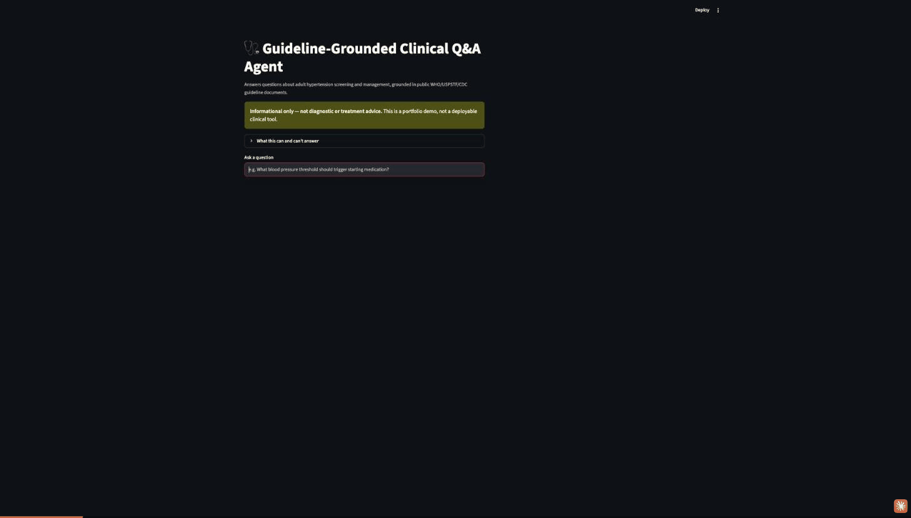

# Guideline-Grounded Clinical Q&A Agent

A retrieval-augmented generation (RAG) app that answers questions over public
WHO, USPSTF and CDC guideline documents on adult hypertension. Every answer
lists its source document, publisher and page. It declines to answer when the
question is outside the guidelines' defined scope or isn't well covered by the
corpus.

**Informational only — no diagnostic or treatment advice. This is a
demonstration built on public documents, not a deployable clinical tool.**



> **Note on "agent":** this is a fixed retrieve → check → generate pipeline,
> not a tool-using agent. The model doesn't choose actions; the code decides
> every step.

## What it does

Answers questions about **adult hypertension screening and management**,
grounded in three public guideline documents. It declines in two cases:

- **Out of scope by design:** hypertensive emergencies/urgencies, specific
  drug dosing, and secondary/resistant hypertension — topics the WHO
  guideline itself explicitly excludes.
- **Low retrieval confidence:** the closest passage in the corpus isn't
  similar enough to the question.

Everything runs locally through Ollama — no cloud API, no API keys.

## How it works

### Offline: building the index (`notebooks/01_ingest.ipynb`, run once)

```
3 PDFs (98 pages)
  → PyPDFLoader: one Document per page, stamped with title, publisher, source URL
  → RecursiveCharacterTextSplitter (4000 chars, 400 overlap) → 108 chunks
  → nomic-embed-text via langchain-ollama → 768-dim, unit-length vectors
  → FAISS IndexFlatL2 (exact search) → data/faiss_index/
```

The chunk size is large on purpose: WHO recommendation pages run about
1,600–4,000 characters, so most recommendations stay in one chunk together
with their strength and certainty rating.

### Online: answering one question (`app/qa.py` → `ask()`)

```
question
  │
  ├─ 1. SCOPE CHECK — 3 regexes on the question text
  │       match → decline (no embedding, no LLM call)
  │
  ├─ 2. RETRIEVE — embed the question, FAISS top-4 chunks with squared-L2 scores
  │
  ├─ 3. CONFIDENCE CHECK — best chunk's score > 0.59 → decline (no LLM call)
  │
  ├─ 4. GENERATE — 4 chunks + question in a grounding prompt (~5,100 tokens)
  │       → llama3.2:3b with num_ctx=8192
  │
  └─ 5. CITE — "Title (Publisher), p. N" built from the chunks' metadata
```

The checks are ordered cheapest and most decisive first, so a question that
will be declined never pays for the LLM call.

**Why the scope check runs before retrieval.** A dosing question is
*similar* to the corpus — WHO discusses the same drug classes — so it would
pass a similarity threshold. Scoring can't catch "relevant but forbidden",
so a separate rule handles it, and it runs first because it costs nothing.

**How the confidence threshold was set.** Vectors are unit length, so the
squared-L2 score runs from 0 (identical) to 4 (opposite) and equals
2 − 2·cosine. The best-chunk scores for six test questions:

| Question | Type | Top-1 score |
|---|---|---|
| What does USPSTF recommend for screening adults for high BP? | answerable | 0.329 |
| What BP threshold should trigger starting medication? | answerable | 0.342 |
| Strategies to help patients manage hypertension at a practice level? | answerable | 0.433 |
| Chemotherapy regimen for stage 4 lung cancer? | unanswerable | 0.745 |
| Fix a null pointer exception in Java? | unanswerable | 1.185 |
| Capital of France? | unanswerable | 1.209 |

The threshold of **0.59** sits at the midpoint of the gap (0.433 → 0.745),
which is roughly cosine 0.705. This is a small, hand-picked set — see
Known limitations.

**Citations come from metadata, not from the model.** The sources list is
built in code from the retrieved chunks' metadata, so the model can't invent a
page or a document. The trade-off: it lists every retrieved page, not only
the ones the answer actually used.

**The prompt also tells the model to answer only from the provided context**
and to say so when the context doesn't cover the question. This is a soft
third guardrail for questions that pass the threshold but still aren't covered.

## Corpus

All three PDFs are committed in `data/raw/` (~2.8 MB).

| Document | Publisher | Pages | Role |
|---|---|---|---|
| [*Guideline for the pharmacological treatment of hypertension in adults*](https://iris.who.int/server/api/core/bitstreams/f062769d-f075-4a00-87af-0a2106e0bd04/content) (2021) | World Health Organization | 61 | Treatment recommendations 3.1–3.8; its stated exclusions define the scope guardrail |
| [*Hypertension Control Change Package*](https://stacks.cdc.gov/view/cdc/251804), 2nd ed. | CDC (Million Hearts) | 30 | Practice-level strategies: care teams, workflows, protocols |
| [*Screening for Hypertension in Adults*](https://www.uspreventiveservicestaskforce.org/uspstf/recommendation/hypertension-in-adults-screening) (2021 reaffirmation) | U.S. Preventive Services Task Force | 7 | Screening recommendation for adults 18+ |

The WHO guideline is licensed CC BY-NC-SA 3.0 IGO. The CDC and USPSTF
documents are U.S. government publications.

## Stack

Python 3.12, LangChain (`langchain-ollama`, `langchain-community`,
`langchain-text-splitters`), FAISS, Ollama (`llama3.2:3b` for generation,
`nomic-embed-text` for embeddings), Streamlit, Docker.

## Requirements

- Python 3.12
- [Ollama](https://ollama.com) (tested with 0.33.0)
- ~8 GB RAM (developed on an 8 GB Apple Silicon Mac; the 3B model is ~2 GB
  quantized)
- Docker Desktop (optional)

## Setup

1. **Install Ollama, start it, and pull both models:**
   ```bash
   ollama pull llama3.2:3b
   ollama pull nomic-embed-text
   ```
   Ollama must be running (`ollama serve`, or the background app) for both
   the app and the ingestion notebook.

2. **Create a virtualenv and install dependencies:**
   ```bash
   python3.12 -m venv .venv
   source .venv/bin/activate
   pip install -r requirements.txt
   ```

3. **The corpus and FAISS index are already in the repo** (`data/raw/`,
   `data/faiss_index/`), so you can run the app without an ingestion step. To rebuild
   the index (e.g. after changing chunking), install Jupyter and run
   `notebooks/01_ingest.ipynb` top to bottom. **If you rebuild the index or
   change the embedding model, recalibrate the threshold**, because the score
   scale may change.

## Usage

**Locally:**
```bash
python -m streamlit run app/app.py
```
Opens at `http://localhost:8501`. (`python -m` makes sure you get the venv's
Streamlit, not a system copy.)

**Via Docker:** the container runs the Streamlit app; Ollama runs on the
host.
```bash
docker build -t clinical-qa-agent .
docker run -p 8501:8501 clinical-qa-agent
```
On Linux, add `--add-host=host.docker.internal:host-gateway` to the `run`
command (Docker Desktop on Mac/Windows handles this automatically). Tested
with Docker Desktop on macOS (Apple Silicon).

## Example Q&A

**A question the corpus covers, answered with citations:**

> **Q: What does USPSTF recommend for screening adults for high blood
> pressure?**
>
> The US Preventive Services Task Force (USPSTF) recommends screening for
> hypertension in adults 18 years or older with office blood pressure
> measurement (OBPM).
>
> Sources:
> 1. Screening for Hypertension in Adults (U.S. Preventive Services Task
>    Force), p. 2
> 2. Screening for Hypertension in Adults (U.S. Preventive Services Task
>    Force), p. 1
> 3. Screening for Hypertension in Adults (U.S. Preventive Services Task
>    Force), p. 4

Exact wording and source order can vary between runs; the answer's
substance and cited document stay the same.

**A question the scope guardrail declines:**

> **Q: What is the dosage of amlodipine for hypertension?**
>
> This question touches on drug dosing specifics, which the underlying WHO
> guideline explicitly excludes from its scope, so this tool declines to
> answer it. This is informational only — not diagnostic or treatment
> advice.

**A question the confidence guardrail declines:** "What is the chemotherapy
regimen for stage 4 lung cancer?" scores 0.745, above the 0.59 threshold,
so it's declined before the LLM is called.

`notebooks/02_qa_chain.ipynb` builds the chain step by step: retrieval,
generation, citations, and both guardrails, including the threshold testing.

## Troubleshooting

| Symptom | Cause / fix |
|---|---|
| Connection refused on port 11434 | Ollama isn't running → `ollama serve` (or start the app) |
| `model not found` | `ollama pull llama3.2:3b` / `ollama pull nomic-embed-text` |
| `No module named streamlit` | venv not active → `source .venv/bin/activate`, then use `python -m streamlit` |
| Everything (or nothing) is declined after rebuilding the index | Score scale changed → recalibrate the threshold |
| Sources are unrelated pages | The embeddings class used for queries differs from the one that built the index → rebuild the index with `langchain-ollama` |
| Code change has no effect in the app | The index and LLM are cached per process → restart Streamlit, don't just refresh |
| Docker app can't reach Ollama on Linux | Add the `--add-host` flag above |

## Project structure

```
app/qa.py             RAG chain + both guardrails (imported by the app)
app/app.py            Streamlit UI
notebooks/            01_ingest (build the index), 02_qa_chain (chain + guardrails)
data/raw/             Source PDFs
data/faiss_index/     Built FAISS index
docs/                 Demo GIF
```

## Known limitations

- **Scope regexes match phrasings, not intent.** Questions with a number plus
  "mg" (e.g. "sodium 2300 mg per day?") are wrongly declined as dosing, and
  phrasings like "doses", "dosages", "how much amlodipine should I take",
  "hypertensive crisis" or "resistant HTN" aren't caught.
- **The threshold was calibrated on six questions**, and the unanswerable
  ones are obviously off-topic. Near-miss questions (e.g. pediatric
  hypertension, hypertension in pregnancy) weren't tested, and there's no
  labeled evaluation set.
- **Citations list every retrieved page**, not only the pages the answer
  relies on — a sources list, not per-claim citations.
- **No evaluation of answer faithfulness**; generation uses the default
  temperature, so answers aren't deterministic.
- **Retrieval isn't tuned:** chunk size wasn't compared against alternatives,
  and the Nomic task prefixes (`search_document:` / `search_query:`) aren't
  used.
- **PDF extraction is imperfect** on tables and multi-column pages, and some
  recommendations span page breaks.
- **Engineering:** no automated tests; Ollama being down shows a raw
  connection error; the FAISS wrapper and PDF loader come from
  `langchain-community`, which is being sunset; the committed index is a
  pickle loaded with `allow_dangerous_deserialization`.
- **Not publicly hosted** — it needs a local Ollama, so it runs locally or
  in Docker.

## Next steps

1. A labeled evaluation set (answerable / near-miss / out-of-scope) to
   measure retrieval hit rate and decline precision/recall, and to re-pick the threshold.
2. Replace the scope regexes with an intent classifier.
3. Add Nomic task prefixes and compare chunk sizes.
4. Per-claim citations: number the chunks in the prompt and keep only the
   ones the model cites.
5. Unit tests, CI, a friendly error when Ollama is down, temperature 0.
